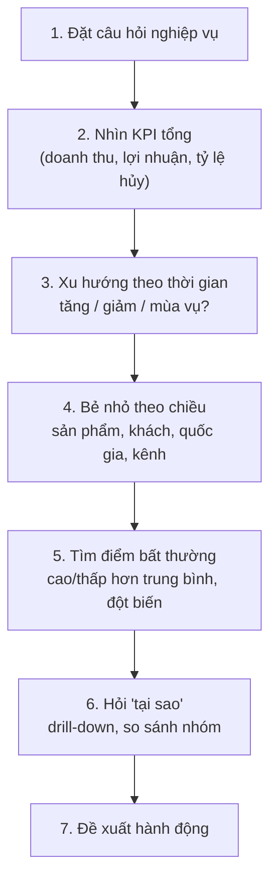

# Cách tìm insight

## 1. Insight là gì (và không phải là gì)

- **Không phải insight:** "Doanh thu năm 2023 là 3,8 triệu $." (chỉ là đọc số)
- **Là insight:** "Doanh thu 2023 tăng gấp đôi so với 2022 (+105%), trong khi số khách chỉ tăng 83% -> mỗi khách đang mua nhiều hơn." (có so sánh, có ý nghĩa, dẫn tới hành động)

Một insight tốt trả lời được 3 câu: **Cái gì?** (phát hiện) -> **Bằng chứng?** (số, chart) -> **Vậy thì sao?** (đề xuất).

---

## 2. Flow tìm insight (Macro -> Micro)

1. **Câu hỏi nghiệp vụ** - viết ra trước khi mở dữ liệu. Ví dụ: "Shop đang tăng trưởng không?", "Tiền đến từ đâu?", "Mất tiền ở đâu?"
2. **KPI tổng** - con số lớn nhất, làm nền cho mọi so sánh sau.
3. **Xu hướng** - line chart theo tháng. Nhìn: tăng/giảm, mùa vụ, điểm gãy.
4. **Bẻ nhỏ** - cùng 1 KPI chia theo từng chiều (dimension). Chiều nào có chênh lệch lớn thì đào tiếp.
5. **Bất thường** - nhóm nào lệch xa trung bình? Tháng nào đột biến?
6. **Tại sao** - đi xuống thêm 1 cấp (category -> brand -> sản phẩm), hoặc so 2 nhóm với nhau.
7. **Đề xuất** - hành động cụ thể, đo được.

---

## 3. Các kỹ thuật so sánh hay dùng

| Kỹ thuật | Câu hỏi | Chart | Ví dụ trong project |
|---|---|---|---|
| So với kỳ trước | Tăng hay giảm? | Line, card có MoM/YoY | Doanh thu 2023 +105% so với 2022 |
| So với trung bình | Nhóm nào tốt / kém hơn mặt bằng? | Bar + đường trung bình | Jeans biên 46,5% < trung bình 51,9% |
| Tỷ trọng (share) | Ai đóng góp bao nhiêu %? | Bar 100%, donut (ít nhóm) | Outerwear chiếm 12,1% doanh thu |
| Pareto 80/20 | Bao nhiêu % sản phẩm tạo ra 80% doanh thu? | Pareto (bar + line tích lũy) | (tự tính trên dashboard) |
| Top / Bottom N | Cái gì tốt nhất, tệ nhất? | Bar ngang có sắp xếp | Top 8 category |
| Tỷ lệ (ratio) | Hiệu quả thế nào? | Card, bar | Biên lợi nhuận, tỷ lệ hủy, conversion |
| Phân nhóm (segment) | Nhóm khách nào khác biệt? | Bar theo nhóm tuổi, quốc gia | Tỷ lệ mua lại theo nguồn traffic |
| Funnel | Rơi rụng ở bước nào? | Funnel | Giỏ hàng -> mua chỉ ~42% |
| Phân phối | Giá trị điển hình là bao nhiêu? | Histogram, boxplot | Giá lệch phải -> dùng median |
| Tương quan | A có ảnh hưởng B không? | Heatmap, scatter | Giá không ảnh hưởng tỷ lệ hủy |

**Visual có sẵn trong Power BI giúp tìm insight:**
- **Decomposition tree**: bẻ 1 KPI theo nhiều chiều liên tiếp, tự tìm nhánh cao nhất/thấp nhất.
- **Key influencers**: tìm yếu tố ảnh hưởng nhiều nhất tới 1 chỉ số (ví dụ: cái gì làm tăng tỷ lệ hủy).
- **Q&A visual**: gõ câu hỏi bằng tiếng Anh, Power BI tự vẽ chart.

---

## 4. Viết insight lên slide

**Khung 3 dòng:**

> **Phát hiện:** Jeans là danh mục doanh thu cao thứ 2 nhưng biên lợi nhuận chỉ 46,5%, thấp hơn trung bình shop (51,9%).
> **Bằng chứng:** [ảnh scatter doanh thu vs biên lợi nhuận từ dashboard]
> **Đề xuất:** Đàm phán lại giá vốn với nhà cung cấp Jeans hoặc tăng giá 3-5% cho nhóm sản phẩm bán chạy nhất.

**Tiêu đề slide = câu kết luận**, không phải tên chart.
- Kém: "Doanh thu theo danh mục"
- Tốt: "Jeans bán chạy nhưng lời ít hơn trung bình"

---

## 5. Lỗi hay gặp

- **Nói tương quan khi không có.** Dữ liệu không cho thấy mối liên hệ thì nói thẳng "không có tương quan" và đề xuất thu thập thêm dữ liệu. Đó vẫn là một kết luận có giá trị.
- **Tương quan không phải nhân quả.** "Khách mua nhiều đơn có doanh thu cao" không có nghĩa là "ép khách đặt nhiều đơn sẽ tăng doanh thu".
- **So sánh kỳ không đầy đủ.** Năm 2024 chỉ có tháng 1 -> không so YoY với năm 2023 đầy đủ.
- **Dùng mean cho dữ liệu lệch.** Giá bán lệch phải -> dùng median.
- **Số không truy được nguồn.** Mọi con số trên slide phải tìm lại được trong dashboard/notebook.

---

## 6. Câu hỏi gợi ý cho dataset này

**Tăng trưởng:** Doanh thu tăng đều hay có tháng đột biến? Mùa nào bán chạy? Tăng trưởng do có thêm khách hay do khách mua nhiều hơn?
**Sản phẩm:** Danh mục nào vừa doanh thu cao vừa biên cao? Brand nào chiếm phần lớn doanh thu? Bao nhiêu % sản phẩm tạo 80% doanh thu?
**Khách hàng:** Quốc gia/nhóm tuổi nào mua nhiều? Men hay Women nhiều hơn? Kênh traffic nào mang lại doanh thu cao?
**Vận hành:** Tỷ lệ hủy/trả có thay đổi theo thời gian không? Trung tâm phân phối nào xử lý nhiều hàng nhất?
